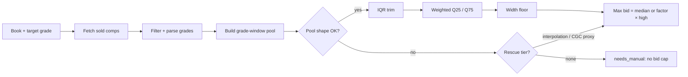
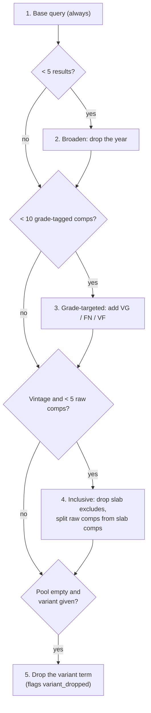
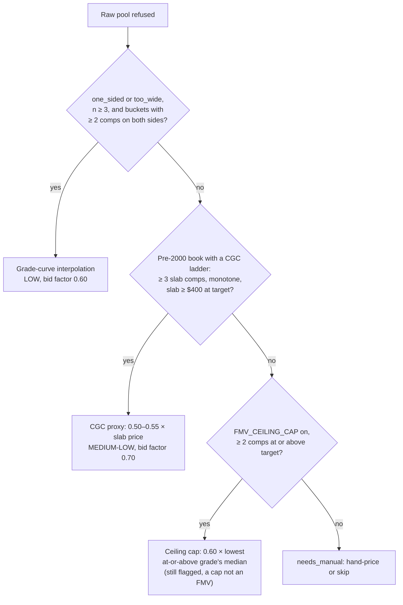
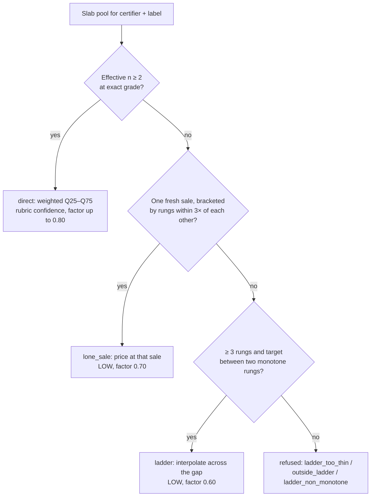

# How we calculate fair market value (FMV)

This document explains how `comic-fmv` prices a comic: the data it uses, where that data comes from, how it builds the price band, and how the band becomes a bid cap. It describes the method and the reasons for it. For exact constants, edge cases, and the manual fallback, see [`docs/conventions/fmv-math-spec.md`](../conventions/fmv-math-spec.md). For how to run the tool, see [`.claude/commands/comic/fmv.md`](../../.claude/commands/comic/fmv.md).

## The short version

FMV is the middle half of recent eBay sold prices for the same book at nearby grades.

1. Fetch recent eBay **sold** listings for the book.
2. Drop listings that are not comparable (lots, reprints, slabs, damaged copies, other currencies).
3. Read a grade from each listing title.
4. Keep the comps near the target grade, widening the window only as far as needed.
5. Remove price outliers.
6. Take the recency-weighted 25th and 75th percentiles as the band (`fmv_low`–`fmv_high`).
7. Widen any band narrower than 40% of its midpoint.
8. Set the max bid. A confident raw book bids its median. A less certain one bids a fraction of `fmv_high`: 80% normally, lower when the comps or the grade are uncertain.

If the comps can't support an honest number, the book is flagged `needs_manual` and gets no bid cap. A refused price is safer than a wrong one.



## Data sources

| Source | What it gives | When it's used |
|---|---|---|
| **sold-comps.com** | eBay sold listings from the last ~90 days, up to 240 results per query | Every fresh price |
| **Your own auctions** (first-party) | Final prices of your resolved WON and LOST snipes in the last 365 days | Merged into the raw pool when both wins and losses exist |
| **Comps ledger** | Every comp past runs stored on the comics server | Slab pricing, and an advisory band when the live fetch fails |
| **eBay Browse API** | Active Buy It Now asks | Display only, on refused rows |

### Why sold prices, not asking prices

An asking price is what a seller wants. A sold price is what a buyer paid. Only sold prices enter a pool. Active asks appear on refused rows as a ceiling (`asks from $X`), never as a price.

### Why first-party comps need both wins and losses

A win tells you the market cleared at or below your bid. A loss tells you it cleared above it. Merging wins alone would drag the price down on every run. So when the server returns only wins for a book, `comic-fmv` drops them all.

## How comps are fetched

`comic-fmv` doesn't call eBay itself. It shells out to the `ebay-sold-comps` console script, which builds queries and runs a base query plus up to five conditional tiers per book. Every query goes to sold-comps.com, the only provider. `ebay-sold-comps` needs `SOLD_COMPS_KEY` and exits with an error when it's missing.

`comic-fmv` checks each input row first. It refuses a `title` that looks copied from a listing, such as one with a spaced-dash tagline or a whole-word grade like `Fine/VF`. The row gets the source `skipped_listing_title` before any fetch or write.

### The base query

```text
"<title> <issue>" <year> <variant> <publisher qualifier> -cgc -cbcs -graded -slab
```

- **Quoted title and issue** stop eBay matching "Spawn" and "98" separately.
- **Year** separates a vintage book from its modern relaunch at the same issue number.
- **Publisher qualifier** keeps trading cards and toys out:
  - Marvel adds `marvel`.
  - DC adds nothing, because `dc comics` halved recall.
  - Indie publishers add their name (for example, `image comics`).
- **Slab exclusions** keep graded copies out of a raw pool. Slabs sell in a different market.
- **Vintage hardening** applies to pre-2000 books on a rebootable masthead (ASM, X-Men, Batman). It adds `-variant -foil -virgin -reprint -facsimile -homage -timeless`.

### The tiers

Each extra tier runs only when the pool is still thin, so most modern books cost one query.



Vintage books with a renamed masthead also get one probe under the other name. The deeper pool wins.

### Filtering

Every comp passes these gates before it can enter a pool:

- **Hard excludes** drop lots, reprints, facsimiles, foreign editions, trading cards, coverless or damaged copies, missing pages, wrong volumes, PSA/PGX slabs, signed copies, and restored copies.
- **USD gate** drops any comp whose price can't be proven to be US dollars. The row reports `non_usd_dropped=N` so a currency drop isn't mistaken for an illiquid book.
- **Dedupe** removes the same sale returned twice under two IDs, for example a stored comp and a fresh one.
- **Grade parsing** reads a grade from the title. A numeric grade (`9.2`, `VG 4.0`) wins. Otherwise a letter grade maps to the CGC scale (for example, `VF+` → 8.5, `FN/VF` → 7.0). A comp with no grade can't enter the priced pool.

Comps with no grade still matter. Their median becomes the **ungraded anchor**, a sanity check described in [Warning flags](#warning-flags).

### Caching and budget

- Provider responses are cached for 7 days per exact query string. A re-run with the same inputs is free.
- A priced row in the comics server is reused if it's younger than 7 days (`--max-age-days`).
- `--force` bypasses both caches. It can't clear a `one_sided` or `too_wide` flag, because it refetches the same market.
- A circuit breaker trips after 5 consecutive provider errors in one run. A tripped fetch is reported as `fetch-err`, never as a book with no comps.

## How the band is built (raw copies)

### Step 1: Build the grade-window pool

Price rises with grade, so the pool should sit as close to the target grade as possible. The window starts at ±0.5 and widens in 0.5 steps until it holds at least 5 graded comps or reaches ±2.0.

```text
Target 8.0

±0.5   |        [7.5 ─────── 8.5]          stop here if ≥ 5 comps
±1.0   |     [7.0 ───────────── 9.0]
±1.5   |  [6.5 ─────────────────── 9.5]
±2.0   |[6.0 ──────────────────────── 10.0]  ceiling
```

### Step 2: Check the pool's shape

A wide or lopsided pool produces a misleading median. These checks refuse it.

| Flag | Condition | Why it's refused |
|---|---|---|
| `too_sparse` | Fewer than 2 comps survive trimming, or 2 comps more than 3× apart | One or two sales aren't a market |
| `one_sided` | Every comp sits above, or every comp below, the target grade | The estimate is biased in one direction |
| `too_wide` | Comps bracket the target but span more than 2.0 grade points | A 5.0 and a 9.0 averaged together price neither |
| `variant_dropped` | Comps appeared only after the variant term was dropped | The pool prices the base cover, not the variant |

```text
one_sided (target 9.6):    ● ● ● ●  ●            ▲
                          8.0      9.0          9.6   no comps above → refused

too_wide (target 7.0):     ●            ▲            ●
                          5.0          7.0          9.0  span 4.0 > 2.0 → refused

priced (target 8.0):          ●   ● ● ▲ ●   ●
                             7.5      8.0      8.5   brackets, span 1.0
```

### Step 3: Trim outliers

`comic-fmv` drops prices outside `Q1 − 1.5×IQR` to `Q3 + 1.5×IQR`. It uses the inclusive quartile method, which behaves well on the 5 to 15 comp pools typical here. Typical outliers are a mislisted slab or a damaged copy that slipped through.

### Step 4: Weight by recency

Newer sales count more. Each comp's weight halves every 75 days, measured from the newest sale in the pool:

```text
weight = 0.5 ^ (days older than newest sale / 75)

age (days)   0     75    150   225
weight      1.00  0.50  0.25  0.13
```

The sum of the weights is the **effective n**. It feeds the confidence rubric, so a pool of many stale sales can't claim high confidence on count alone.

### Step 5: Take the band

- `fmv_low` = weighted 25th percentile.
- `fmv_high` = weighted 75th percentile.
- `median` = weighted median.

Each value is rounded to a clean step: $5 below $50, $10 from $50 to $200, $25 above $200.

The band is the middle half of the market, not a single point. You can expect a fair copy to sell anywhere inside it.

### Step 6: Apply the width floor

Small pools often produce bands too narrow to hold the real sale. Any band narrower than 40% of its midpoint widens to 40% around the same midpoint. A replay against 586 resolved auctions found 40% scored best. The row carries `width_floor=0.40`.

```text
before:        [70 ─ 80]          width 10 / mid 75 = 13%
after:    [60 ─────────── 90]     width 30 / mid 75 = 40%
```

### Step 7: Score confidence

Confidence comes from effective n and the coefficient of variation (CV = standard deviation ÷ median):

| Effective n | CV | Confidence |
|---|---|---|
| ≥ 8 | < 25% | HIGH |
| ≥ 6 | < 30% | HIGH |
| ≥ 5 | < 35% | MEDIUM-HIGH |
| ≥ 4 | < 45% | MEDIUM |
| ≥ 3 | any | MEDIUM-LOW |
| < 3 | any | LOW |

A pool built wider than ±1.0 caps at MEDIUM, however deep it is.

### Step 8: Set the max bid

The rubric label maps to one of five bid tiers:

| Bid tier | Rubric label |
|---|---|
| VERY HIGH | HIGH, with window ±0.5 and CV < 25% |
| HIGH | Any other HIGH |
| MEDIUM | MEDIUM-HIGH or MEDIUM |
| LOW | MEDIUM-LOW |
| VERY LOW | LOW |

A raw book priced directly in the VERY HIGH, HIGH, or MEDIUM tier bids its median, as long as no photo haircut applies:

```text
max_bid = 1.00 × median   (clean-rounded, never above fmv_high)   bid_basis = "median"
```

Every other case bids a fraction of `fmv_high`:

```text
max_bid = bid_factor × fmv_high   (clean-rounded)                 bid_basis = "high"
```

That covers the LOW and VERY LOW tiers, any engaged grade haircut (factor below 0.80), and the interpolated, CGC-proxy, ceiling, and slab paths.

Why the split: `fmv_high` sits about 1.2× the median for confident books but 1.5× to 2.3× for weak ones. On our resolved auctions, bidding the median lifted the VERY HIGH win rate from 28% to 50%. The same rule on LOW books would cut their win rate from 43% to 38%. See [`docs/audit/2026-10-10-median-bid-factor-backtest.md`](../audit/2026-10-10-median-bid-factor-backtest.md).

The comics server stores the median and the bid tier. Its `over_fmv` and `recomputed_cap` policy checks re-derive the same cap from them.

The bid factor reflects how sure we are, on two separate axes:

- **Comp confidence**: how good the price evidence is (the rubric above).
- **Grade confidence**: how well the photos support the grade, from `/comic:grade`.

When a grade confidence is supplied, the more conservative of the two sets the factor:

| Combined confidence | Bid factor |
|---|---|
| MEDIUM or better | 0.80 |
| MEDIUM-LOW | 0.70 |
| LOW | 0.60 |

With no grade confidence (a seller-stated grade), the factor stays at 0.80. Interpolated prices and ceiling caps are always capped at 0.60. When the factor drops below 0.80, the median rule steps aside, so a photo haircut can only lower the bid.

### Worked example

Target: VF 8.0. Seven sold comps come back.

| Grade | Price | Outcome |
|---|---|---|
| 6.0 | $40 | Outside ±0.5, not in pool |
| 7.5 | $60 | Kept |
| 8.0 | $70 | Kept |
| 8.0 | $75 | Kept |
| 8.0 | $80 | Kept |
| 8.5 | $95 | Kept |
| 8.0 | $300 | Trimmed as an outlier (IQR bounds $41–$121) |

1. The ±0.5 window holds 6 comps, so it doesn't widen.
2. The pool brackets 8.0 and spans 1.0 grade point. The shape passes.
3. The trim drops $300. Five comps remain: $60, $70, $75, $80, $95.
4. Q25 = $70, Q75 = $80, median = $75 (published as $80 after rounding).
5. The band is 13% wide, so the floor widens it to **$60–$90**.
6. n = 5 and CV = 17%, so confidence is **MEDIUM-HIGH** and the bid tier is **MEDIUM**.
7. Max bid = the median, **$80** (`bid_basis` median).

With a photo grade confidence of `medium-low`, the haircut engages instead. Max bid = 0.70 × $90 = $63, rounded to **$60** (`bid_basis` high).

## When the direct pool can't price

A refused pool gets one or more rescue attempts, in this order. Each one is more conservative than a direct price.



### Grade-curve interpolation

If grade buckets exist on both sides of the target, the price is read off a straight line between the nearest bucket medians:

```text
price = median_below + (target − grade_below) / (grade_above − grade_below) × (median_above − median_below)

$       ●  (9.0, $140)
        |  ╱
        | ▲  target 8.5 → $115
        |╱
        ●  (8.0, $90)
```

Each anchor bucket needs at least 2 comps. A single mislisted sale shouldn't set a bid cap.

### CGC proxy

For an expensive pre-2000 book with too few raw sales, slab sales are often deeper. `comic-fmv` builds a grade-to-price ladder from eBay CGC and CBCS sales, reads the slab price at the target grade, and prices the raw copy at 50–55% of it. The factor is calibrated on vintage books only, from paired raw and slab sales (ASM #50: CGC 6.5 ≈ $1,200, raw 6.5 ≈ $635–$700). It never extrapolates past the observed ladder. The proxy requires a slab price of at least $400, because certification costs distort the ratio on cheaper books.

### Ceiling cap

Off by default, behind `FMV_CEILING_CAP=1`. It gives a refused book a deliberately low bid cap. The row stays flagged and `fmv_low`/`fmv_high` stay empty, so no report reads the cap as a price.

### Ledger advisory

When the live fetch fails, `comic-fmv` prices the book from stored ledger comps if at least 3 survive. The row shows a `LEDGER` band with no max bid, and nothing is written to the database. Use it as a starting point for a hand price, never as a cap.

## Slab (CGC/CBCS) pricing

A certified slab is priced from that certifier's own slab sales. It never touches the raw pool, and no raw discount applies. Only Universal (blue label) CGC and CBCS slabs are auto-priced. Signature Series, Qualified, Restored, and Conserved labels trade in their own markets, so they go to `needs_manual`.

Slab grades are exact. A 9.6 and a 9.8 are different products, so there's no grade window. The pool combines live slab sales with stored ledger sales, weighted by calendar age:

| Sale age | Weight |
|---|---|
| ≤ 90 days | 1.0 |
| 91–365 days | 0.5 |
| > 365 days | Excluded |

A best-offer sale reports the listing's asking price, not the accepted offer (BUI-1222). The slab pool prices those comps at 0.89× the reported price (BUI-1234). The raw pool is not scaled.



Page quality is a preference, not a wall. A sale whose title doesn't state page quality matches any target quality. Only a sale that states a different quality is left out. When the same-quality exact-grade bucket is thin, exact-grade sales of any page quality price the book before the ladder does.

A lone sale at the exact grade is never the price on its own. It qualifies only when neighbouring grades on both sides agree with it. Otherwise it's dropped and the ladder interpolates across it. A slab listed as Buy It Now is still priced, but gets no max bid, because there's no auction to snipe.

## Warning flags

These tokens appear in `fmv_notes`. None of them changes the price. Surface them and leave the bid as computed.

| Token | Meaning |
|---|---|
| `ungraded_anchor=$X (n=N raw)` | Median of comps with no parsed grade, a coarse market check |
| `anchor_diverges=1` | The priced band sits far from that anchor |
| `proxy_below_anchor=1` | A CGC-proxy band tops out below the raw anchor |
| `cgc_cross_check` divergence | A thinly priced vintage book's raw price is more than 40% off its slab-implied price |
| `first_party=N` | N of the comps are your own auction results |
| `ask_ceiling=$X (nN)` | Lowest active Buy It Now ask on a refused row |
| Hot-market signal | The live bid already exceeds `fmv_high` |

`comic-fmv --inversion-sweep` reports a second class of problem. It finds books where a higher grade is priced below a lower grade of the same book. It reads stored rows only and costs no provider requests.

## Hand-priced rows

A row with `fmv_provenance = 'hand'` is an operator's override. A default run skips it and reports `skipped_hand_priced`. Only `--force` overwrites one, and it prints the old notes first.

## How we check the method

- `/comic:accuracy-report` scores each resolved auction's final price against the band it was bid against.
- `/comic:calibration-report` ranks books whose FMV looks too low, based on wins above `fmv_high`.

Proposed changes to the method are backtested against resolved auctions before they ship. The width floor, the ceiling cap, and the slab tiers each went through this process. Rejected ideas and their measurements are recorded in `docs/audit/` and the Linear tickets cited in the math spec.

## Related documents

- [`docs/conventions/fmv-math-spec.md`](../conventions/fmv-math-spec.md): full math spec and manual fallback.
- [`.claude/commands/comic/fmv.md`](../../.claude/commands/comic/fmv.md): how to run `comic-fmv` and read its output.
- `apps/fmv/src/fmv_math.py`: the pricing math.
- `apps/ebay/src/sold_comps.py`: query building, fetching, and filtering.
